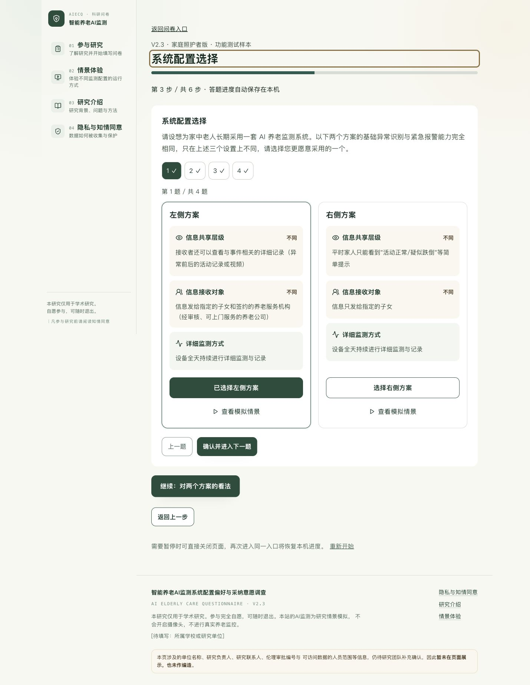
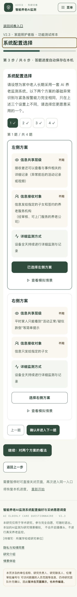

# 智能养老问卷 V2.3 代码检查与交付报告

> 历史快照：下文记录11月1日初次实施，不是最新验收。11月2日已改为固定六授权题序、a11模式互斥、b4新选项、隐藏团队字段及简化共同前提/首页。最新规则与283项测试结果见 [修订说明](2026-11-02_更新与Supabase操作说明.md)，数据库操作以 [最新手册](V2.3_Supabase操作手册.md) 为准。

日期：2026年11月1日。项目：`SheenaYI/ai-elderly-care-questionnaire`。本次工作在已有本地仓库内完成，没有重建项目、改换部署平台、推送代码或执行正式数据库迁移。

## 1 修改前实际检查结果

本地分支工作区起初干净。起始提交为 `851bcc7`。已读取近期提交并执行 `git fetch origin` 核对远端；本地相对 `origin/main` 领先17个提交、落后0个，没有用远端旧版本覆盖本地修改。

技术结构是 React 18 + TypeScript + Vite + Tailwind + Zustand + React Router。Netlify 以薄适配层调用 `api/` 的共用处理函数；Supabase提供 PostgreSQL、Auth和RLS。

修改前目录：

```text
src/app/                    原问卷Zustand状态与路由
src/data/                   V1.1问卷、12个旧DCE任务、12项量表与配置
src/pages/                  首页、体验、介绍、隐私、合并问卷
src/features/questionnaire/ 知情同意、情景、总体、理想配置与提交
src/features/dce/           原每卷6题DCE
src/features/ratings/       原4配置×12项评价
src/features/simulation/    可复用的模拟监测与视频
src/features/admin/         研究员登录、旧统计和导出
api/                        提交与鉴权导出共用实现
netlify/functions/          Netlify接口适配器
supabase/                   schema与0001–0004迁移
tests/                      原248项自动测试
```

检查后确认：当前仓库实际上还没有独立老人卷和照护者卷；它是V1.1合并问卷，每人6道DCE、4配置×12项评分，并必须回答“理想配置”。本次没有假定旧代码已经符合V2.2/V2.3。

原数据链路：浏览器草稿→`/api/submit-survey`→结构/研究语义/版本/重复检查→服务端service_role调用`submit_survey`，由数据库事务写入旧表。原后台使用Supabase Auth邮箱密码登录，并校验`research_admins`白名单；浏览器只读权限由RLS控制，CSV经服务端再次鉴权。

旧库结构及关系：`questionnaire_versions`登记版本；`participants`为主表；`dce_choices`、`profile_ratings`、`comprehension_checks`、`simulation_events`、`survey_responses`、`custom_config_choices`通过participant_id关联主表。`research_admins`和`research_config`分别控制授权与研究配置。旧列有年龄/身份枚举、非空分卷、12个非空评分、Q6/Q7题号等约束。

仓库RLS设计为匿名无研究数据权限，authenticated仅白名单管理员可读，写入经service_role服务端RPC。本次没有线上凭据，无法确认真实Supabase是否与这些迁移完全一致。

## 2 已落实的内容与冲突处理

- 独立老人、家庭照护者入口；新版本固定V2.3，主问卷题号小写。
- 老人a1–a12，照护者b0–b12；注意力题依定稿增加为小写a-check/b-check，不挤占既有题义。
- 老人居住选项为“和其他家庭成员一起住”；b2为“其他家庭成员”；b0不符合资格即终止。
- 老人三道三档偏好编码0/50/100；C4→C7→C8构成递进的6个授权情景，分别询问自行调整和需子女同意，题序随机，都可以单独记录。
- 照护者A卷T01/T02/T07/T08，B卷T04/T05/T06/T10；每人4题，严格使用批准配对。
- 两卷均随机抽2个不同配置、每配置8项评分，分别使用老人/照护者原文；无旧12项混入。
- 100分模式须三项均填、为0–100整数、合计100；按V2.3保留老人确实无法打分时“仅排序”兜底并留空分数。
- a10/b10最多2项；注意力题保留原答与通过标记，不自动删除记录。
- 基础识别与详细记录分别解释；补充全天详细监测方案按X3运行的说明，防止公共前提与X3=1自相矛盾。
- 经用户确认，李阿姨跌倒史已在两卷统一为“一年前在家中滑倒过”；其余题目保持定稿含义。
- 配置描述使用附录C分句，固定X1→X2→X3顺序。没有加入价格、准确率、速度差异，没有增加opt-out或启用Pilot备选任务。
- 未将V1.1额外理想配置题继续混入V2.3；原组件、旧记录与旧导出保留。

## 3 修改与新增文件

| 文件 | 主要变动 |
| --- | --- |
| `src/features/surveyV23/content.ts`（新增） | V2.3全部题干/选项、三属性分句、8个DCE任务、8项双版本量表、版本与类型 |
| `src/features/surveyV23/model.ts`（新增） | 独立草稿结构、固定随机计划、恢复与保存、8配置快照、6授权情景映射 |
| `src/features/surveyV23/validation.ts`（新增） | 前后端共用严格校验：题号、资格、任务与位置、评分、权重、配对、时间、快照 |
| `src/features/surveyV23/Fields.tsx`（新增） | 大点击区域的选项、配置属性图示和1–5评分控件 |
| `src/features/surveyV23/ExperimentStep.tsx`（新增） | 老人三档/授权实验、照护者4题DCE、确认与导航 |
| `src/features/surveyV23/OverallStep.tsx`（新增） | 总体采纳、最多2项担忧、100分/排序、注意力和开放题 |
| `src/features/surveyV23/SurveyPage.tsx`（新增） | 双卷入口和完整6步流程；刷新恢复；资格终止；提交与失败保留 |
| `src/features/surveyV23/analysis.ts`（新增） | 新版统计与8类结构化导出，缺失值不填0，DCE长表分清原方案与实际位置 |
| `src/features/surveyV23/AdminPanel.tsx`（新增） | 新版独立后台、分页读取、正式/预测试/测试及人群筛选 |
| `src/app/router.tsx` | 正式问卷入口改为双卷；旧问卷路径回到入口，防止继续收集旧题 |
| `src/pages/HomePage.tsx` | 两个独立主入口、最新基础识别说明，移除旧草稿6题/4配置提示 |
| `src/pages/AboutPage.tsx` | 同步新版评分措辞、每维2项与标准属性说明 |
| `src/pages/PrivacyPage.tsx` | 同步结题后一年内删除的规则 |
| `src/components/layout/SiteFooter.tsx` | 显示V2.3，保留实际待补研究联系信息提示 |
| `src/data/placeholders.ts` | 数据保存期限使用定稿已确认内容，其他未提供信息不编造 |
| `src/features/simulation/SimulationModal.tsx` | 新问卷可隐藏配置编码，用当前方案标签；保留原模拟交互 |
| `src/styles/index.css` | 新问卷进度条使用现有深绿体系 |
| `src/lib/config.ts` | 新版运行版本固定V2.3，环境变量不能改写研究版本 |
| `src/lib/randomization/index.ts` | 共用随机工具的运行时导入改为相对路径，确保服务端打包可解析 |
| `api/submit-survey.ts` | 新版结构化校验与独立RPC；旧版新提交拒绝并提示重新填写，历史数据不变 |
| `api/admin/export.ts` | 沿用原登录/白名单鉴权，新增新版分表与长表导出及筛选 |
| `src/features/admin/AdminPage.tsx` | 增加V2.3区域，旧统计与导出保留并标为历史数据 |
| `.env.example` | 注明固定V2.3及sample_channel区分，原变量架构保留 |
| `.gitignore` | 临时数据库验证依赖和中间结果不进入仓库 |
| `README.md`、`supabase/README.md`、`docs/SUPABASE_SETUP.md`、`docs/DATA_DICTIONARY.md` | 增加新版交接指引，将旧文档明确标为历史参考，避免重跑初始化或误用旧字典 |
| `supabase/migrations/0005_survey_v23.sql`（新增） | 新表、RLS、RPC、3视图和默认停用的版本登记；不动旧表/RPC |
| `docs/source/questionnaire-v23.txt`（新增） | 从提供的定稿DOCX提取的原文快照，便于复核；保留原文冲突，与用户确认的覆盖说明分开 |
| `tests/v23.test.ts`（新增） | 研究编码、差分秩、随机稳定、校验与导出统计 |
| `tests/v23Flow.test.ts`（新增） | 老人、照护者A/B全流程实际点击；资格终止；评分/权重与提交 |
| `tests/v23Backend.test.ts`（新增） | Netlify提交与导出边界替身测试，验证失败关闭和鉴权 |
| `tests/v23Fixtures.ts`（新增） | 仅功能测试渠道的完整测试答卷构造器 |
| `tests/rendering.test.ts` | 首页按钮断言与双入口同步 |
| `outputs/`（新增交付资料） | 本报告、操作手册、数据字典、完整SQL副本、预览截图 |

React/Vite/Netlify/Supabase技术栈、原依赖版本、登录系统与旧统计实现没有被替换。临时PostgreSQL测试依赖只安装在被忽略的work目录，没有改动项目package依赖。

## 4 数据兼容性和迁移影响

新答卷存入`survey_v23_submissions`的JSONB完整载荷及独立索引列；查询视图和后台CSV提供平铺数据，不是只存最终显示文字。主表版本固定V2.3、老人split=null、照护者split=A/B、样本渠道独立；按人群和版本筛选可复现。

迁移默认登记V2.3为inactive，必须由负责人确认后才启用。历史数据不回填新题号，不把Q6/Q7伪装成a7/b7，也不把旧12项量表缩成8项。旧草稿保留在旧localStorage键下，不能无损转换为新版。新API会拒绝旧版继续提交，需研究团队向正在填写旧问卷的人说明。

新版表一行一份答卷，主键防重复；同一编号同答案的网络重试幂等，不同答案不能覆盖已有记录。版本登记、RPC、底表和视图权限受控制。没有开放匿名读写，没有把service_role放进前端。

## 5 已执行的测试

| 检查 | 结果与范围 |
| --- | --- |
| TypeScript与生产构建 | `npm run build`通过，包含`tsc --noEmit`和Vite构建 |
| 全部自动测试 | 15个测试文件、277项通过；原248项继续保留，新29项覆盖V2.3 |
| 老人全流程 | DOM实际点击：资格/同意→背景→理解检查→三档→6情景→16评分→总体/权重→本地演示提交，成功 |
| 照护者A/B全流程 | 两卷分别完成，任务数4、配对及最终选中配置正确；无实际照护经历不能继续 |
| 随机化 | 200份计划检查两卷、左右交换覆盖、恰好4题、两个不同评价配置、确定性复核和本机恢复 |
| 研究设计 | 固定C1–C8编码、8对正式任务、两分卷差分矩阵秩均为3 |
| 数据校验 | 漏评分、重复配置、错误分卷/位置/方案、篡改首次理解答案、错误权重、无资格均拒绝 |
| 排序与注意力 | 老人仅排序分数保持null；都可以不合并；注意力不通过原答保留 |
| Netlify提交与导出 | 内存Supabase替身验证接口/RPC载荷、未启用拒绝、重复冲突、无配置503、未登录401、非管理员403与渠道筛选 |
| Netlify函数打包 | 两个函数通过Node20目标的esbuild本地打包；不代表已在Netlify部署 |
| 隔离PostgreSQL | PGlite内存库实际执行完整迁移两次；默认停用、两卷写入、视图行数、历史哨兵不变、幂等重试、覆盖拒绝、100分校验、排序空值、管理员/非管理员/anon权限均通过 |
| 浏览器桌面/手机 | 实际打开老人入口及照护者流程；1440px桌面与390px手机DCE、评分页检查，无横向溢出；配置卡按屏幕转双列/单列 |
| 页面设计检测 | 新模块无机械错误；保留旧监测画布网格的提示为已知advisory，符合模拟画面的使用语境 |

已有测试中“伪造令牌拒绝”会访问虚构`dummy.supabase.co`并记录预期的网络失败，不涉及真实研究数据。新增提交/导出测试使用内存替身，隔离数据库测试未连接任何Supabase项目。

## 6 尚未验证的线上事项

以下不能声称已经通过：真实Supabase字段/RLS是否与仓库相同；队友账号的真实登录与权限；真实Netlify Functions到Supabase的网络/环境配置；正式项目中V2.3写入和导出；真实手机硬件的浏览器兼容性。

还存在的限制：

- 尚需负责人批准并由队友执行0005迁移；未执行时新版接口不会保存成功。
- 新版本默认停用；验收后才可启用。网页和数据库不是同一次部署。
- 旧数据单独保留。新版后台读不到新表时显示说明，旧后台仍可工作。
- 本机草稿不上传，中途退出不写正式库；后台无法获知未提交人数。
- 随机分卷不是实时强制1:1配额；程序随机分配，后台按实际提交数监测A/B数量。
- 原IP限流仍是单实例内存限流，多实例之间不共享；没有把它宣称为全局防刷。
- 学校、研究联系人、负责人、伦理审批和具体退出联系方式尚未提供，现有待填写提示保留。正式发放前应补齐。
- 数据保留承诺是结题后一年内删除；团队须按实际结题时间执行，本次未自动设置删除任务。
- 100分“仅排序”不纳入分数均值；注意力题不通过不自动删除，最终样本规则须按研究计划执行。

## 7 上线交接

1. 负责人先审查本报告、`V2.3_Supabase操作手册.md`与完整`0005_survey_v23.sql`。
2. 队友做真实数据库只读核对和备份，批准后执行增量迁移；不要清空旧库或重跑旧初始化。
3. 代码同学提交到团队分支，建立Netlify预览部署，核对原有环境变量；无新增必需变量。
4. 按手册启用V2.3后，用`?channel=test`完成真实链路测试；后台切到功能测试渠道核对。正式默认统计不纳入这些测试答卷。
5. 补齐联系/研究单位信息，团队确认后正式发布，发放两个独立入口。

本地已启动预览服务：`http://127.0.0.1:5173/questionnaire`。Vite本地预览不运行Netlify后端；没有云端配置时会明确显示演示结果，不会伪装已写入Supabase。

## 8 预览

桌面：



手机：


